# Learning Journey

Learning Journey is an iOS app that turns learning into a daily habit. The learner sets what they want to learn and for how long, then logs each day as learned or uses a freeze to protect their streak. A calendar keeps a record of the whole journey.

Built with SwiftUI for the **Hello World** challenge at **Apple Developer Academy**, based on designs provided by the Academy.

<table>
  <tr>
    <td align="center">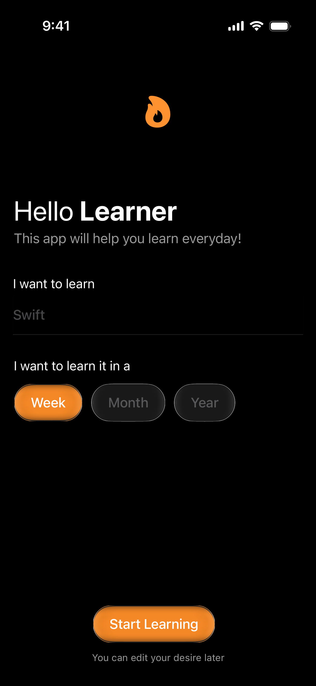<br>Onboarding</td>
    <td align="center">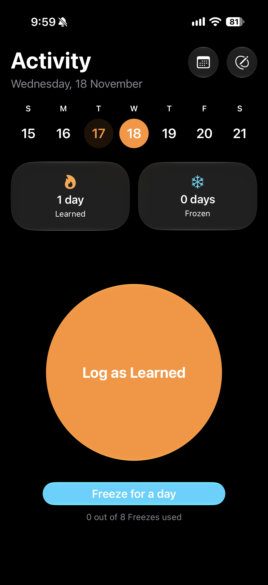<br>Activity</td>
    <td align="center">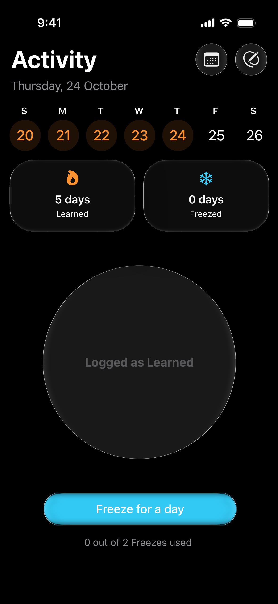<br>Logged</td>
    <td align="center">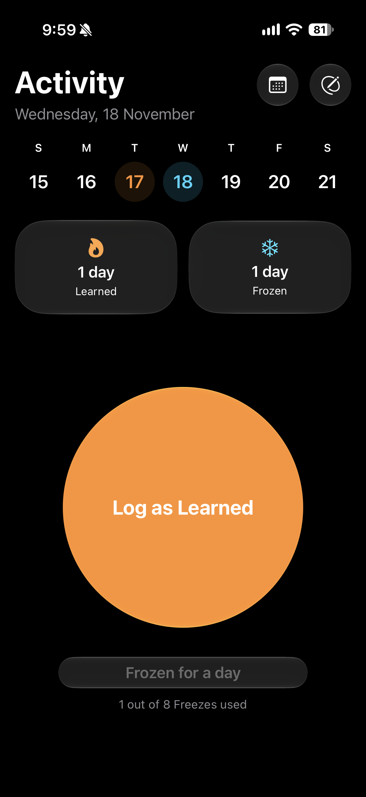<br>Frozen</td>
  </tr>
  <tr>
    <td align="center">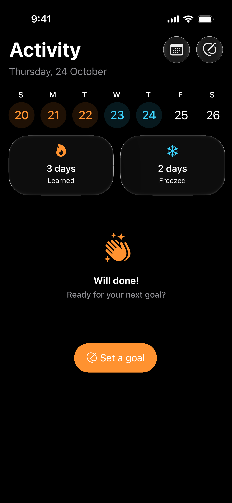<br>Goal completed</td>
    <td align="center">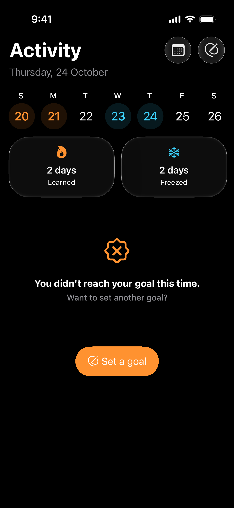<br>Goal not reached</td>
    <td align="center">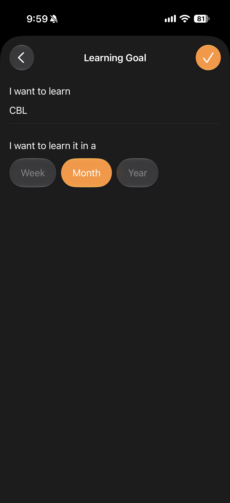<br>Edit goal</td>
    <td align="center">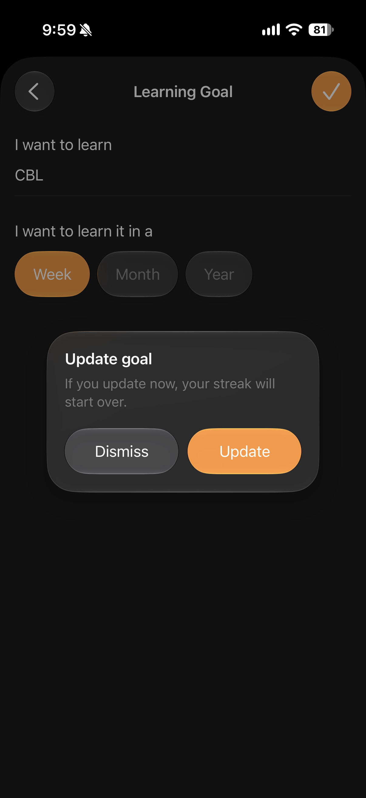<br>Update confirmation</td>
  </tr>
  <tr>
    <td align="center">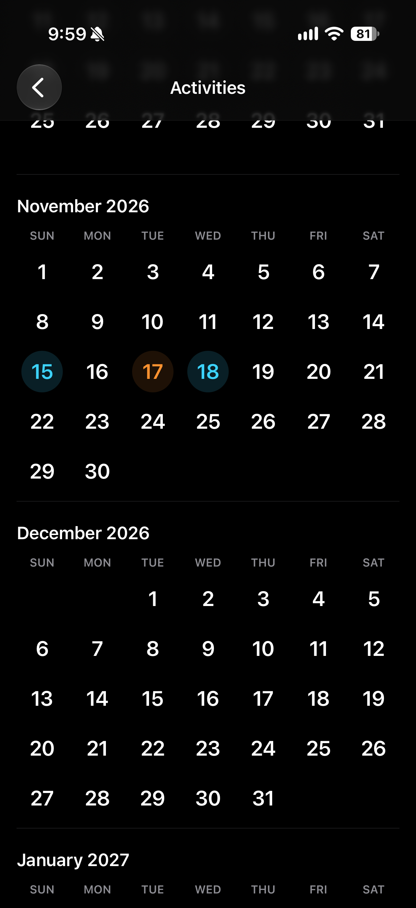<br>Calendar</td>
    <td align="center">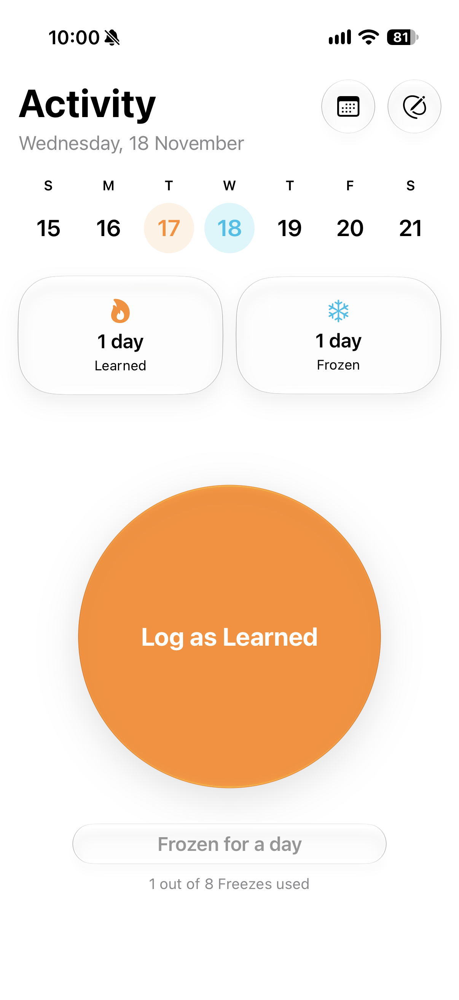<br>Light Mode</td>
    <td></td>
    <td></td>
  </tr>
</table>

## Features

- **Onboarding:** choose a topic and a duration of a week, a month, or a year.
- **Daily logging:** log the day as learned, or freeze it on days you cannot study.
- **Streak and freeze counters** that update instantly.
- **Goal outcome:** a success state when the last day is logged, and a failure state as soon as the streak breaks.
- **Edit goal:** change the topic or duration, with a confirmation before the streak restarts.
- **Calendar:** a ten-year history of every learned and frozen day.
- **Light and Dark Mode**, Liquid Glass components, haptics, and VoiceOver support.

## Rules

| Rule | Behavior |
|---|---|
| Durations | Week: 7 days. Month: 30 days. Year: 365 days. |
| Freeze limits | 2 per week, 8 per month, 96 per year. |
| Streak | Each learned day adds one. A frozen day keeps the streak without increasing it. |
| Break | More than 32 hours without learning or freezing ends the goal as not reached. |
| New day | Buttons become available again at 12 AM. Until then, today can be switched between learned and frozen. |
| Updating the goal | The streak and freezes start over, and the calendar history is kept. |

## Architecture

The app follows **MVVM** with a separate **Services** layer.

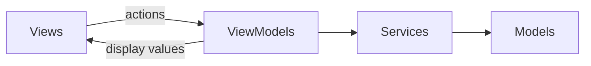

| Layer | Responsibility |
|---|---|
| **Models** | Plain data: `LearningGoal` and `Day`. |
| **Services** | Business rules (`StreakService`, `GoalService`) and the single source of truth for stored data (`ProgressStore`). |
| **ViewModels** | One per screen. Prepares display values and handles user actions. |
| **Views** | Display only. Reusable pieces live in `Views/Components`. |

## Key Decisions

- **Derived streak:** the streak is calculated from the saved days instead of being stored, so it can never fall out of sync.
- **Anchor date:** each goal stores its start date. Updating the goal moves the anchor instead of deleting history.
- **No polling:** the Activity screen calculates the next moment something will change, such as midnight or the 32-hour limit, and refreshes only then.
- **Injected clock:** the current time is passed into the ViewModel, which makes time-based behavior testable.
- **Fixed calendar:** the app always uses a Gregorian calendar starting on Sunday, regardless of device settings.

## Testing

**40 tests** written with **Swift Testing** cover the 32-hour boundary, midnight changes, freeze limits, goal success and failure, goal updates, and calendar generation. Run them in Xcode with **Cmd + U**.

SwiftUI previews with mock data show every state of the Activity screen and a filled calendar.

## Getting Started

**Requirements:** Xcode 26 or later, iOS 26 or later.

```bash
git clone https://github.com/RA5l/Learning-Journey.git
cd Learning-Journey
open LearningJourney.xcodeproj
```

Choose an iPhone simulator and press **Cmd + R**.

## Author

**Raseel** ([@RA5l](https://github.com/RA5l))

Designs and challenge specification by Apple Developer Academy.
